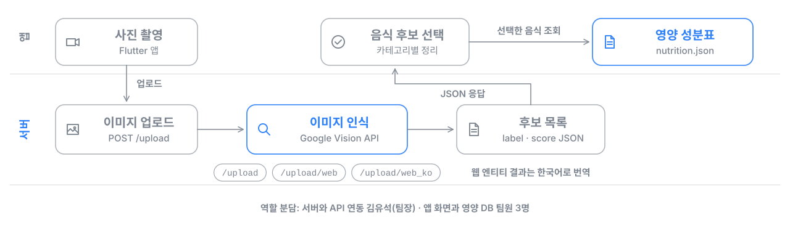

# Food Scan — 사진 한 장으로 음식 영양 정보 확인

음식 사진을 찍으면 이미지 인식으로 음식 후보를 찾고, 고른 음식의 영양 성분표를 보여 주는 모바일 앱입니다. 2022년 SW중심대학 안동대, 제주대 연계 캡스톤 디자인에서 4인 팀으로 개발한 수상작입니다.



## 한눈에 보기

- **기간**: 2022년 11월 ~ 12월 (4인 팀)
- **나의 역할**: 팀장. FastAPI 이미지 인식 서버 구현, Flutter 앱과 서버 연동, 일정 관리
- **동작**: 앱에서 사진 업로드 → 서버가 Google Vision으로 음식 라벨 인식 → 앱에서 후보 선택 → 영양 정보 DB에서 성분표 표시

## 서버 API

| 엔드포인트 | 설명 |
| --- | --- |
| `POST /upload` | 이미지 라벨 인식 결과(label, score) 반환 |
| `POST /upload/web` | 웹 엔티티 인식 결과 반환 |
| `POST /upload/web_ko` | 웹 엔티티 결과를 한국어로 번역해 반환 |

## 구성

| 폴더 | 설명 |
| --- | --- |
| `FASTAPI_SERVER/` | 이미지 업로드와 인식을 담당하는 Python 서버 |
| `Flutter_Client/` | 촬영, 후보 선택, 성분표 화면을 담당하는 모바일 앱 (`assets/json/nutrition.json`에 영양 정보 DB 포함) |

## 실행 방법

**서버**

```bash
cd FASTAPI_SERVER/vision_fastapi-master
python -m venv venv && source venv/bin/activate
pip install -r requirements.txt
# Google Cloud 서비스 계정 키를 auth-key/auth-key.json에 둡니다 (저장소에는 올리지 않음)
uvicorn main:app --host 0.0.0.0 --port 8000
```

**앱**

```bash
cd Flutter_Client
flutter pub get
flutter run
```

## 기술 스택

- 모바일 앱: Flutter, Dart
- 서버: Python, FastAPI
- 이미지 인식: Google Cloud Vision API

## 팀원

<table>
  <tr>
    <td align="center"><a href="https://github.com/TaeGyungKim"><br/><sub><b>김태경</b></sub></a></td>
    <td align="center"><a href="https://github.com/NAMUORI00"><br/><sub><b>김유석 (팀장)</b></sub></a></td>
    <td align="center"><a href="https://github.com/jymh22"><br/><sub><b>이홍규</b></sub></a></td>
    <td align="center"><a href="https://github.com/claris0"><br/><sub><b>선종호</b></sub></a></td>
  </tr>
</table>
